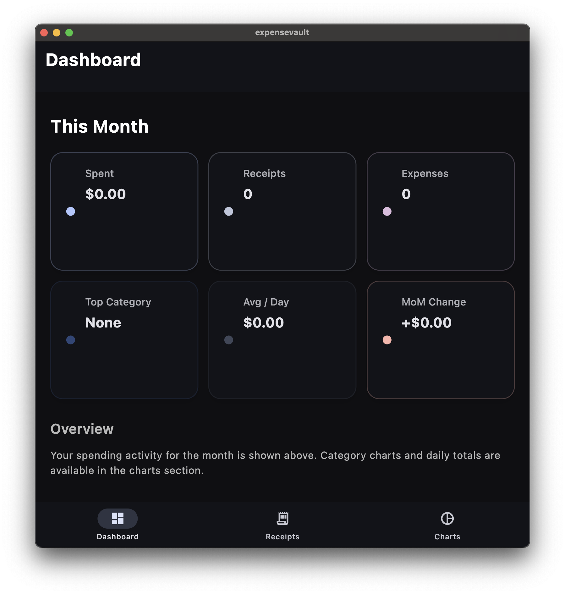
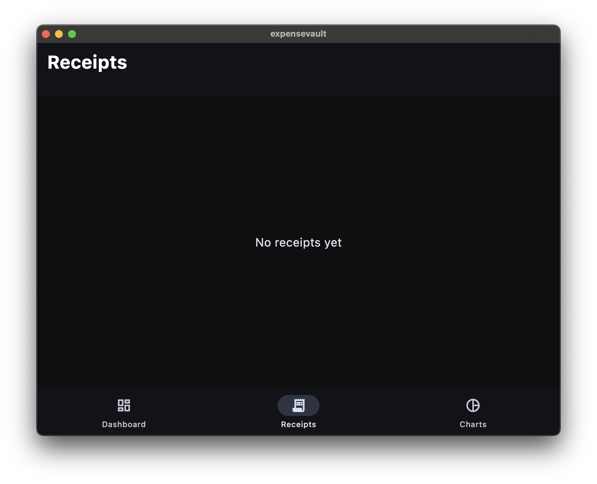
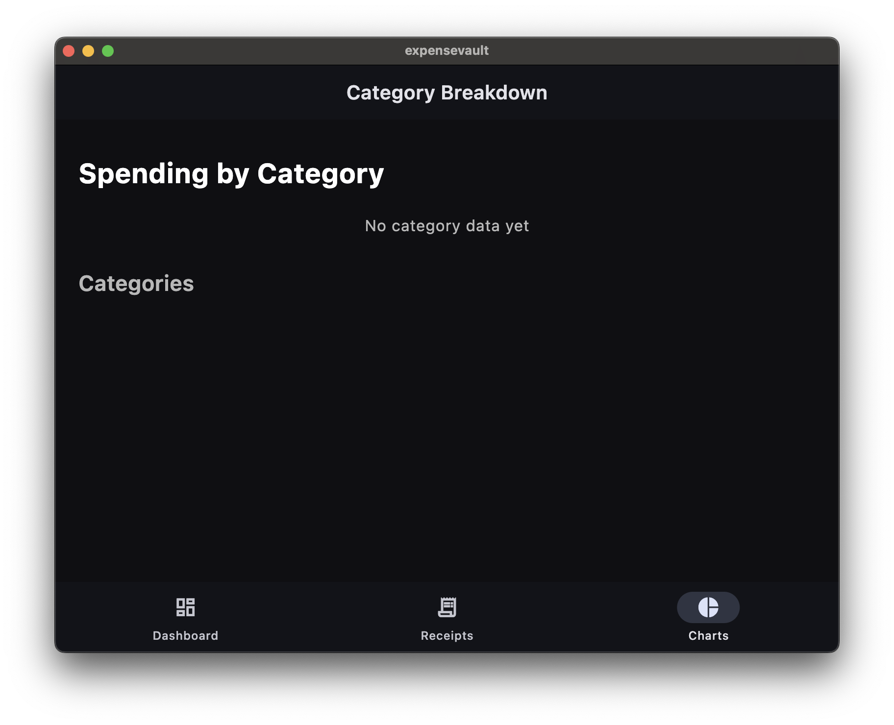

# expensevault
A modern offline‑first expense tracker built with Flutter and Riverpod, featuring an expressive Material 3 design, adaptive layouts, and instant performance.


## Features
### Smart Dashboard
- Monthly spending summary
- Total receipts & expenses
- Top Category
- Average per Day
- Month‑over‑Month Change
- Adaptive grid layout (phones → 2 columns, tablets → 3–4 columns)

### Receipts
- Add and manage receipts
- Offline‑first storage
- Clean, expressive UI

### Expenses
- Track expenses with categories
- Automatic monthly totals
- Category breakdowns
- Daily totals for charts

### Charts
- Category breakdown
- Daily spending chart
- Designed for clarity and simplicity

### Expressive Material 3 Theme
- Custom typography
- Light + dark themes
- Soft surfaces and modern card design
- Dashboard‑friendly color palette

### Responsive Layout
- Adaptive grid
- Tablet‑friendly spacing
- Desktop‑friendly scaling

### Offline‑First Architecture
- Instant UI
- No loading states
- All data stored locally
- Fast, reliable, and private

## Screenshots
Add your screenshots here:




## Tech Stack
- Flutter (Material 3)
- Riverpod (state management)
- Hive / Local storage (offline-first)
- Dart
- Adaptive UI / Responsive design

## Getting Started

1. Clone the repo
```bash
git clone https://github.com/iNoles/expensevault.git
cd expensevault
```
2. Install dependencies
```bash
flutter pub get
```
3. Run the app
```bash
flutter run
```
